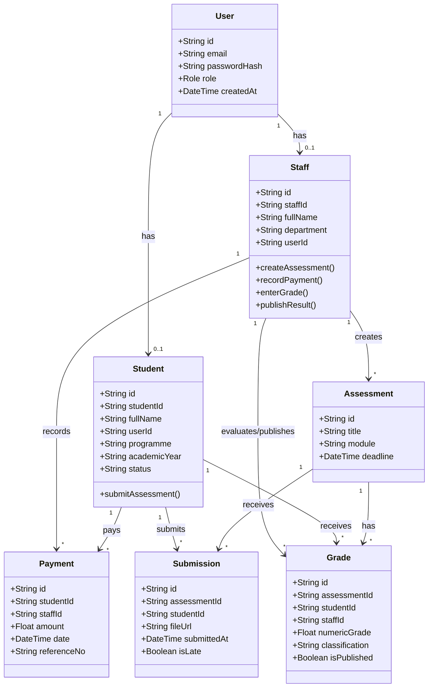

# Student Management System - Registry Module

A focused web application built for Registry Administrators to handle the core day-to-day administrative workflows of a student management system. Designed with a clean, feature-driven architecture using Next.js App Router and Prisma ORM.

---

## Technical Stack & Toolbox

- **Frontend & Framework:** Next.js 14+ (App Router)
- **Language:** TypeScript
- **Database & ORM:** PostgreSQL, Prisma ORM
- **State Management & Data Fetching:** TanStack Query (React Query)
- **API Client:** Axios
- **Styling & UI:** Tailwind CSS
- **Authentication:** JWT Cookie-based session management
- **File Handling:** Local storage integration for PDF & DOCX student submissions

---

## Overview & Core Workflows (Module-Wise Architecture)

This application is structured into distinct feature modules, serving as the blueprint for both frontend feature boundaries and backend API route handlers:

1. **Authentication & Authorization Module:**
   * **Scope:** Manages secure user login, credential verification, and session sessions (`Staff` vs. `Student` roles).
   * **Work:** Handles protected route redirection, role-based dashboard views, and secure JWT cookie generation.

2. **Student Enrolment Module:**
   * **Scope:** Manages core registry admission and student lifecycle records.
   * **Work:** Create student profiles, auto-generate unique student IDs (`SMS-YYYY-XXXX`), update academic statuses (`Enrolled`, `Deferred`, `Withdrawn`, `Completed`), and provide real-time dynamic search and filtering.

3. **Fees & Payments Module:**
   * **Scope:** Tracks financial obligations, tuition fees, and payment settlements.
   * **Work:** Assign programme-based fees, record transaction details (amount, date, reference number), calculate real-time outstanding balances, and flag overdue student accounts on the staff dashboard.

4. **Assessment Submission Module:**
   * **Scope:** Handles coursework creation and digital submissions.
   * **Work:** Staff publish assessments (title, module, deadline), while students upload PDF/DOCX files with resubmission support and automated `isLate` timestamp tagging for late entries.

5. **Marksheet & Results Module:**
   * **Scope:** Manages evaluation, automated grading classification, and secure result publishing.
   * **Work:** Staff input numeric grades (`0–100`), system auto-calculates classifications (`Pass >= 40`, `Merit >= 60`, `Distinction >= 70`), and registry controls allow secure publishing or withholding of individual student marksheets.

---

## Database Schema



## Folder Structure

```text
README.md                       # Quick Start, Getting Started, Architecture Overview, and AI Usage
.env.example                    # Environment variables template

src/
├── app/                        # ROUTING LAYER (Next.js App Router: layout.tsx, page.tsx, API route handlers)
│   ├── api/                    # Backend API endpoints (modularized by resource)
│   │   └── [resource-name]/    # Resource collection endpoints (GET list, POST create)
│   │       ├── route.ts
│   │       └── [id]/           # Dynamic resource item endpoints (GET single, PUT/PATCH update, DELETE)
│   │           └── route.ts
│   ├── (group-name)/           # Route group for isolated layouts (Staff & Student views)
│   └── page.tsx                # Root page
├── components/                 # GLOBAL PURE UI (Shared presentation primitives: Button, Modal, Table, etc.)
├── features/                   # THE CORE DOMAIN (Business boundaries isolated cleanly by feature)
│   └── [feature-name]/         # Modular domain feature (repeat as needed)
│       ├── components/         # UI blocks specific to this feature
│       ├── hooks/              # Feature-specific custom hooks
│       ├── services/           # Unified API contracts (fetch/client requests)
│       ├── utils/              # Pure helper functions for this feature
│       └── types/              # Domain types and interfaces
├── lib/                        # CORE CONFIGURATIONS & SERVICES (Prisma client, Auth configuration)
├── hooks/                      # GLOBAL UI HOOKS (App-wide general UI hooks)
└── types/                      # GLOBAL TYPES (Shared core TypeScript interfaces)

prisma/
├── schema.prisma               # Database schema configuration
└── seed.ts                     # Database seeding script

docs/                           # TECHNICAL DOCUMENTATION HUB (For developers & AI context)
├── index.md                    # Documentation Hub Index & Master Architecture Blueprint
└── features/                   # Feature-specific technical documentation
    └── [feature-name]/         # Feature documentation (overview.md, api.md, components.md)
        ├── overview.md         # Business logic and user workflows for this feature
        ├── api.md              # API endpoints, request/response contracts for this feature
        └── components.md       # Key UI components and state management specific to this feature
```