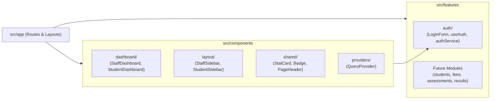

# Application UI & Component Architecture

This document outlines the organization, design principles, and specifications for global UI presentation components located under `src/components/`.

---

## 1. Domain Separation Philosophy

The project adheres to a clean boundary between domain features and application presentation:

* **`src/features/[feature]/components/`**: Exclusively for domain-specific business components that depend on feature services, hooks, or mutations (e.g., `LoginForm` in `features/auth`, student enrolment modals in `features/students`).
* **`src/components/`**: House all application shells, overviews, responsive layout navigations, and reusable UI primitives.



---

## 2. Directory Breakdown

### 2.1. `src/components/dashboard/`
Role-specific overview landing pages providing high-level operational summaries and quick-jump navigation cards to core modules:
* **`StaffDashboard.tsx`**: Registry Administrator workspace overview highlighting key workflows (Enrolment, Fees, Assessments, Marksheet) with role-tailored metrics and action cards.
* **`StudentDashboard.tsx`**: Student self-service hub providing quick access to active tuition balance, coursework uploads, and examination grade releases.
* **`index.ts`**: Barrel export.

### 2.2. `src/components/layout/`
Responsive navigation shells configured for desktop and mobile form factors, both featuring the official university logo (`/logo.png`) and sleek dark zinc aesthetic:
* **`StaffSidebar.tsx`**:
  * **Branding**: Styled with the official institutional Royal Blue accent (`#0269ae` / `--brand-blue`).
  * **Desktop**: Fixed left navigation rail (`w-64`) featuring university logo header, active route indicators, user profile summary, and sign-out action with spinner.
  * **Mobile**: Sticky top header with hamburger toggle button (`Menu` / `X`) opening an off-canvas drawer with backdrop blur overlay and body scroll locking.
* **`StudentSidebar.tsx`**:
  * **Branding**: Styled with the official institutional Green accent (`#0a9748` / `--brand-green`).
  * Links to Student Hub, Fees & Ledger, Coursework Submissions, and Marksheet.
* **`index.ts`**: Barrel export.

### 2.3. `src/components/shared/`
Reusable design primitives used across pages and future feature modules:
* **`StatCard.tsx`**: Metric display card supporting icons, badges, titles, numeric values, and descriptive subtitles.
* **`Badge.tsx`**: Flexible status pill supporting multiple color variants (`default`, `primary`, `success`, `warning`, `danger`, `outline`) and sizes.
* **`PageHeader.tsx`**: Reusable hero banner supporting brand themes (Staff Royal Blue, Student Green, and Zinc), subtitle descriptions, and status badges.
* **`Modal.tsx`**: Accessible, responsive dialog overlay with backdrop blur, keyboard `Escape` dismiss, scroll-locking, and customizable `maxWidth` sizing (`sm` to `2xl`).
* **`index.ts`**: Barrel export.

### 2.4. `src/components/providers/`
* **`QueryProvider.tsx`**: Wraps the application with TanStack React Query's `QueryClientProvider` configured with default stale times and query retry policies.

---

## 3. Layout Integration

Both `(staff)` and `(student)` route layouts leverage the sidebar architecture:

```tsx
// src/app/(staff)/layout.tsx
export default function StaffLayout({ children }: { children: React.ReactNode }) {
  return (
    <div className="min-h-screen bg-zinc-50 dark:bg-zinc-950 text-zinc-900 dark:text-zinc-100 flex flex-col md:flex-row">
      <StaffSidebar />
      <div className="flex-1 md:pl-64 flex flex-col min-w-0">
        <main className="flex-1 max-w-7xl w-full mx-auto px-4 sm:px-6 lg:px-8 py-8">
          {children}
        </main>
      </div>
    </div>
  );
}
```
