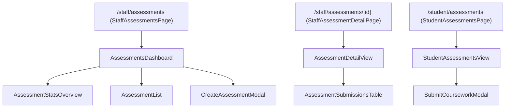

# Assessment Submission — UI Component Architecture

## 1. Component Hierarchy & Flow

---

## 2. Component Specifications

### 2.1. `AssessmentsDashboard`
* **Route:** `/staff/assessments`
* **Role:** Registry Administrator
* **State Management:**
  * `searchTerm` *(string)*: Real-time search by module, title, or degree programme.
  * `programmeId` *(string)*: Filter by degree programme.
  * `statusFilter` *(string)*: Toggle between `'all'`, `'active'`, `'passed'`, and `'archived'`.
  * `limit` *(number)*: Assessments per page (default: `9`).
  * `cursorHistory` *(Array<string | null>)*: UUIDv7 cursor stack for bidirectional pagination.
  * `currentCursorIndex` *(number)*: Pointer within the cursor stack.
  * `page` *(number)*: Current page number.
  * `isCreateOpen` *(boolean)*: Toggles `CreateAssessmentModal`.
* **Hook Integration:** `useAssessments({ search, programmeId, status, limit, page, cursor })`, `useProgrammes()`.

### 2.2. `AssessmentStatsOverview`
* **Presentation:** 4-card metric grid:
  1. *Total Coursework* (Institutional active modules + archived count indicator).
  2. *Active Deadlines* (Deliverables currently open for submissions).
  3. *Submissions Received* (Total files received with on-time tally).
  4. *Late Submissions* (Flagged overdue submissions requiring examination review).

### 2.3. `AssessmentList`
* **Presentation:** Responsive coursework cards displaying:
  * Degree Programme & Module code pills.
  * Coursework title and official deadline.
  * Live deadline countdown badge (green on-time, amber due soon, red deadline passed) or `Archived` pill.
  * Cohort progress bar: `X of Y submitted (Z%)`.
  * Late submissions count alert.
  * Segmented status filter: `[All]`, `[Active]`, `[Past Deadline]`, `[Archived]`.
  * Card Actions:
    * Navigate to cohort roster inspection (`Inspect Cohort Roster`).
    * Active cards: **Archive** button (soft delete setting `isActive: false`).
    * Archived cards: **Restore** button (re-enables assessment setting `isActive: true`).
  * Pagination Footer:
    * Showing page X of Y, total assessments tally.
    * Per-page selector (6, 9, 18, 36).
    * UUIDv7 cursor badge indicator.
    * Next and Previous buttons linked to cursor history.
* **Hook Integration:** `useArchiveAssessment()`.

### 2.4. `CreateAssessmentModal`
* **Role:** Staff coursework publisher.
* **Fields:**
  * Degree Programme select (loads from `useProgrammes()`).
  * Module Code & Name (e.g. `CS101 - Algorithms`).
  * Assessment Deliverable Title (e.g. `Coursework 1: Complexity Analysis`).
  * Submission Deadline (HTML5 `datetime-local` picker).
* **Validation:** Enforces non-empty strings, valid programme selection, and standard date format.
* **Hook Integration:** `useCreateAssessment()`.

### 2.5. `AssessmentDetailView` & `AssessmentSubmissionsTable`
* **Route:** `/staff/assessments/[id]`
* **Role:** Staff submission audits.
* **Presentation:**
  * Cohort KPIs (total enrolled, submitted count, late submission count, submission percentage).
  * Cohort submission roster with student profile, deliverable download links, submission timestamps, and late tags.
  * Cursor-based pagination with UUIDv7 seeks, per-page selector, and status/search filters.
* **Hook Integration:** `useAssessmentSubmissions()`.

### 2.6. `StudentAssessmentsView` & `SubmitCourseworkModal`
* **Route:** `/student/assessments`
* **Role:** Enrolled student portal.
* **Security & Scoping:**
  * Scoped strictly to the student's enrolled degree programme.
  * Strictly restricted to `isActive: true` assessments (archived assessments are completely hidden).
  * Direct file uploads (.pdf, .docx, .doc) up to 20 MB with real-time late submission warning flags.
* **Hook Integration:** `useAssessments()`, `useSubmitCoursework()`.
