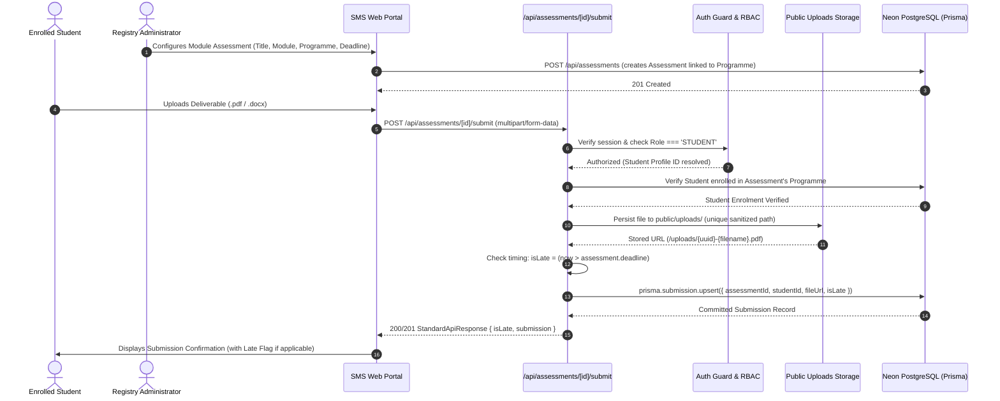

# Assessment Submission — Feature Overview

## 1. Scope & Domain Purpose

The **Assessment Submission** module (Module 3) governs coursework deliverable management, student submission lifecycles, deadline enforcement, and late coursework detection within the Student Management System.

Assessments are configured per degree programme and module by Registry Staff (`Role === 'STAFF'`). Enrolled students submit coursework documents (`.pdf`, `.docx`, `.doc`) against active assignments. Module 3 provides:

1. **Coursework Deliverable Configuration:** Staff creates assessments bound to accredited degree programmes with strict submission deadlines.
2. **Student Self-Service Submission Portal:** Enrolled students view coursework requirements for their active modules, inspect live deadline countdowns, and upload deliverables.
3. **Resubmission Prior to Deadline:** Students can overwrite previous uploads before the deadline without penalties or duplicate database rows.
4. **Automated Late Submission Detection:** Submissions uploaded past the deadline are accepted to preserve academic progress, but are permanently tagged with `isLate = true` and flagged across Registry review rosters.
5. **Cohort Submissions Roster & Auditing:** Registry Administrators inspect real-time cohort completion statistics (On-Time, Late, Missing) and download deliverables directly.

---

## 2. Assessment Creation & Coursework Submission Workflow

---

## 3. Key Architectural & Business Rules

### 3.1. Degree Programme Scoping & Boundary
* Assessments are linked directly to an accredited `Programme` (`Assessment.programmeId`).
* When an enrolled student accesses `/student/assessments`, the query is automatically scoped to their enrolled degree programme (`student.programmeId === assessment.programmeId`).
* Students cannot view or submit coursework deliverables for programmes they are not enrolled in.

### 3.2. Single Submission per Student Constraint
* A composite unique index `@@unique([assessmentId, studentId])` enforces that a student has at most one active submission record per assessment deliverable.
* Database operations utilize Prisma `upsert` with compound key `assessmentId_studentId`.

### 3.3. Resubmission Prior to Deadline
* Students who identify errors or improvements in their deliverables may resubmit before the deadline.
* The resubmission overwrites the existing file URL and file name, refreshes `submittedAt` to the current timestamp, and retains `isLate = false`.

### 3.4. Late Submissions Policy & Flagging
* Submissions past the deadline are accepted so students are not barred from university assessment evaluations.
* However, the server automatically computes `isLate = submittedAt > assessment.deadline` and permanently persists `isLate = true`.
* In both the Staff Submissions Roster and the Student Portal, late submissions are highlighted with high-contrast alert tags to support Board of Examiners penalty policies (e.g. standard UK late deduction regulations).

### 3.5. File Format & Size Restrictions
* Permitted deliverable extensions: `.pdf`, `.docx`, `.doc`.
* Maximum deliverable size: 20 MB.
* Uploaded files are stored with unique, collision-resistant filenames (`${Date.now()}-${uuid}-${sanitizedName}`).

### 3.6. UUIDv7 Cursor-Based Pagination on Submissions
* Cohort submissions roster queries leverage time-ordered UUIDv7 primary keys on `Student` records (`WHERE id < cursor`) to provide constant-time $O(1)$ seek latency instead of degrading $O(N)$ SQL table scans.
* Full cohort submission KPIs (total enrolled, submitted, on-time, late, and missing counts) are pre-aggregated before slicing the paginated roster, eliminating partial-page statistical skew.
* Supports bidirectional page navigation with in-memory cursor history stacks, per-page limit toggles (10, 25, 50), and server-side status/search filtering.

### 3.7. UUIDv7 Cursor-Based Pagination on Assessment Fetch
* As an institution expands and hosts hundreds of active and past modules, fetching assessments via traditional offset pagination incurs performance degradation.
* `GET /api/assessments` incorporates high-throughput $O(1)$ UUIDv7 cursor seeking (`WHERE id < cursor ORDER BY id DESC TAKE limit + 1`).
* Returns `pagination` metadata (`cursor`, `nextCursor`, `prevCursor`, `hasNextPage`, `hasPrevPage`, `page`, `limit`, `totalPages`) for seamless client-side bidirectional navigation.

### 3.8. Soft Deletion (Archival) & Restoration Architecture
* **Non-Destructive Deletion:** Instead of hard-deleting database records (`DELETE FROM "Assessment"`), deletion acts as a soft archive setting `isActive: false`.
* **Submissions & Audit Preservation:** Existing student uploads, timestamps, late flags, and grading trails are fully preserved in the database.
* **Student Exclusion:** Students can never see archived assessments. Normal student endpoints and `/student/assessments` strictly filter `isActive: true`. Direct URL attempts to view archived assessments return `404 Not Found`.
* **Staff Archived Tab:** In the Staff Dashboard, an `[Archived]` filter button is positioned beside `[Past Deadline]`. When selected, only archived coursework items (`isActive: false`) are loaded.
* **Restoration:** Staff can restore any archived coursework back to active status with a single click, instantly reinstating it in the active roster.

---

## 4. Edge Cases & Resolutions

| Scenario | Edge Case | Architectural Resolution |
| :--- | :--- | :--- |
| **Resubmission On-Time** | Student uploads a revised document before the deadline. | Replaces disk file and updates `fileUrl` and `submittedAt`. Keeps `isLate: false`. |
| **Resubmission Late** | Student submits on-time, then uploads a revised file after deadline. | Overwrites file, updates timestamp, and flags `isLate: true` because the latest revision occurred past deadline. |
| **Overdue First Submission** | Student misses deadline and submits 2 days later. | Submission is accepted, file is persisted, and `isLate: true` is permanently stored. |
| **Withdrawn Student** | Student marked as `WITHDRAWN` attempts to submit. | Rejected with `403 Forbidden` ("Withdrawn students are not eligible to submit coursework"). |
| **Cross-Programme Submission** | Student attempts to submit to another degree programme's assessment. | Server validates `student.programmeId === assessment.programmeId`, returning `403 Forbidden`. |
| **Assessment Archiving (Soft Delete)** | Staff deletes an assessment deliverable. | Converted to soft delete: sets `isActive: false`. Hidden from normal views and student portals while preserving submission history. |
| **Assessment Restoration** | Staff restores an archived assessment from the Archived tab. | Sets `isActive: true`, immediately returning it to the active roster for enrolled students and staff. |
| **Finalized Grade Deletion Guard** | Staff attempts to archive or delete an assessment that already has published examination grades. | Server verifies `assessment.grades.length === 0` (or unpublished only). If published grades exist, returns `400 Bad Request` to protect registry audit trails. |

