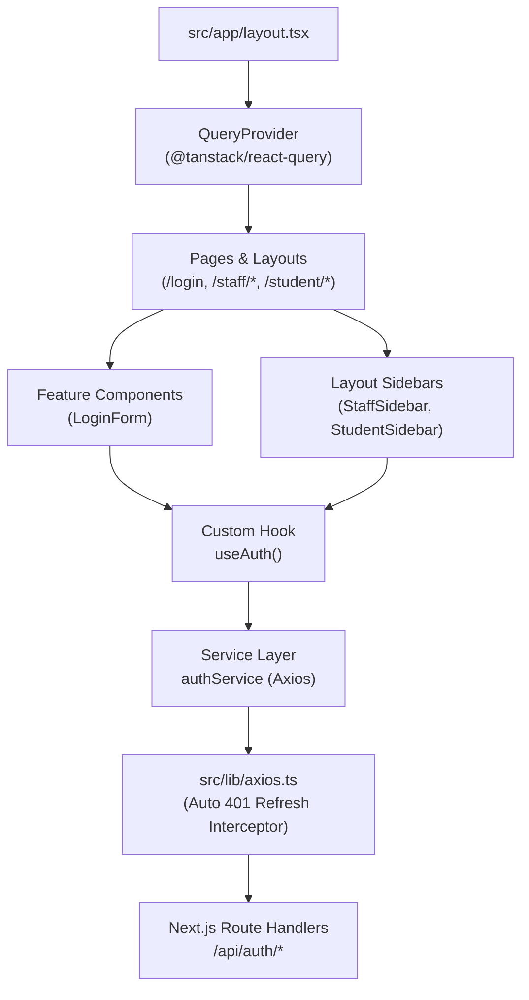

# Auth Module — UI Components, Hooks & UX Architecture

This document covers the UI presentation primitives, TanStack Query hooks, Axios API client, and client UX workflows for the authentication system.

---

## 1. Component & State Architecture

---

## 2. Custom Hooks (`src/features/auth/hooks/useAuth.ts`)

Powered by **TanStack Query (React Query)**:

* **`useAuth()`**:
  * **Session Query (`useQuery`)**: Queries `/api/auth/me` with query key `['auth', 'session']`, keeping session state fresh with automatic deduplication.
  * **Login Mutation (`useMutation`)**: Executes `authService.login(credentials)`, optimistically updates the session cache on success, and performs role-based router navigation (`/staff/dashboard` vs `/student/dashboard`).
  * **Logout Mutation (`useMutation`)**: Calls `authService.logout()`, invalidates all cached query state, and redirects to `/login`.

---

## 3. Key Components

### `LoginForm.tsx` (`src/features/auth/components/LoginForm.tsx`)
* **State Management**: Consumes `login`, `isLoggingIn`, and `loginError` from `useAuth()`.
* **UX Highlights**:
  * **One-Click Quick Fill**: Buttons for *Staff Admin* (`admin@sms.ac.uk`) and *Student* (`alice@sms.ac.uk`) populate credentials instantly.
  * **Loading Indicator**: Disables form inputs and animates submit button during authentication.
  * **Error Handling**: Contextual alert banner for bad credentials or network issues.

### Layout Navigation (`StaffSidebar.tsx` & `StudentSidebar.tsx` in `src/components/layout/`)
* **Layout Design**: Responsive fixed left sidebars for desktop with mobile slide-in off-canvas drawer.
* **State Management**: Reads active user details (`user.name`, `user.email`, `user.staffId`, `user.studentId`) from `useAuth()`.
* **Logout Action**: Executes the `logout()` mutation with inline spinner state.

---

## 4. API Client & Token Refresh (`src/lib/axios.ts`)

* Global Axios instance with `withCredentials: true`.
* **Automatic 401 Interceptor**: Catches expired access token errors, queues concurrent requests, calls `POST /api/auth/refresh`, and seamlessly retries the original request once refreshed.
