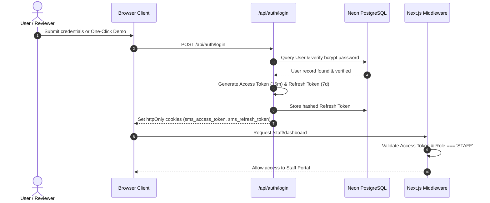

# Auth Module — Feature Overview

## 1. Scope & Purpose

The Authentication & Role Authorization module establishes secure user identity and enforces role boundaries between **Registry Staff** (`STAFF`) and **Students** (`STUDENT`).

It serves as the prerequisite foundation (Module 0) for the entire Student Management System, ensuring that:
1. Administrative operations (student enrolment, recording fees, setting deadlines, publishing grades) are strictly restricted to verified staff sessions.
2. Student self-service operations (uploading submissions, inspecting private fee ledgers, viewing published marks) are scoped exclusively to the authenticated student profile.

---

## 2. Token Lifecycle & Security Strategy

### Key Security Safeguards
* **Storage Protection:** Tokens are never stored in client `localStorage` or `sessionStorage`. They exist exclusively inside secure `httpOnly`, `SameSite=Lax` cookies.
* **Token Rotation:** Each refresh request invalidates the old refresh token and issues a fresh pair.
* **Reuse Detection:** If an already-revoked refresh token is presented (indicating a potential token theft), the backend automatically marks all active sessions for that user as revoked.
* **SHA-256 Hashing:** Raw refresh tokens are never saved as plaintext in the database; only cryptographic hashes are stored.

---

## 3. Pre-Seeded Evaluation Accounts

To facilitate instant testing and evaluation:

| Role | Email | Password | Context |
| :--- | :--- | :--- | :--- |
| **Registry Staff** | `admin@sms.ac.uk` | `Staff@12345` | Registry Administrator (`STF-2025-001`) |
| **Student (Alice)** | `alice@sms.ac.uk` | `Student@12345` | `SMS-2025-0001` (BSc Computer Science) |
| **Student (Brian)** | `brian@sms.ac.uk` | `Student@12345` | `SMS-2025-0002` (BA Business - Overdue balance) |
| **Student (David)** | `david@sms.ac.uk` | `Student@12345` | `SMS-2025-0004` (Late submission flagged) |
| **Student (Emma)** | `emma@sms.ac.uk` | `Student@12345` | `SMS-2025-0005` (Published exam marks) |
