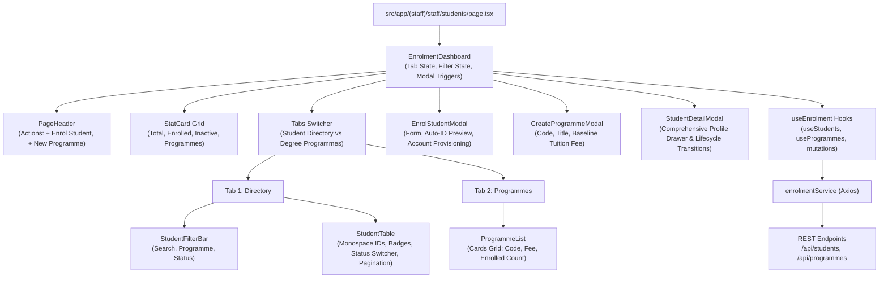

# Student Enrolment & Programmes — Component Architecture & UX

This document covers the UI presentation primitives, TanStack Query hooks, Axios API client, and user experience workflows for the Student Enrolment & Programmes module.

---

## 1. Component Hierarchy & State Flow



---

## 2. TanStack React Query Hooks (`useEnrolment.ts`)

### Query Key Specifications
```typescript
export const ENROLMENT_KEYS = {
  allProgrammes: ['programmes'] as const,
  programme: (id: string) => ['programme', id] as const,
  allStudents: ['students'] as const,
  studentsList: (filters: StudentFilterParams) => ['students', 'list', filters] as const,
  student: (id: string) => ['student', id] as const,
};
```

### Key Hooks
1. **`useStudents(filters)`**:
   - Queries `/api/students` with real-time parameters.
   - Configured with `placeholderData: keepPreviousData` to ensure seamless transitions when changing pages or applying filters.
2. **`useProgrammes()`**:
   - Queries `/api/programmes` with a 5-minute cache time.
3. **`useCreateStudent()`**:
   - Executes `enrolmentService.createStudent(input)`.
   - On success, automatically invalidates `ENROLMENT_KEYS.allStudents` and `ENROLMENT_KEYS.allProgrammes`.
4. **`useUpdateStudentStatus()`**:
   - Executes `enrolmentService.updateStudentStatus(id, status)`.
   - On success, invalidates the student list and the active student detail query.
5. **`useCreateProgramme()`**:
   - Executes `enrolmentService.createProgramme(input)`.
   - Invalidates `ENROLMENT_KEYS.allProgrammes`.

---

## 3. Core Feature Components

### 3.1. `EnrolmentDashboard.tsx`
Top-level workspace orchestrator managing:
* Active tab switching (`Student Directory` vs `Degree Programmes`).
* High-level statistical summaries (Total registered, Actively enrolled, Inactive/Deferred, Programmes count).
* **UUIDv7 Cursor Stack State (`cursorHistory`):** Maintains an ordered array of visited cursors (`[null, cursor1, cursor2, ...]`) paired with `currentCursorIndex`. This bridges $O(1)$ database cursor seeks with intuitive bidirectional Next/Previous UI controls.
* Shared modal dialog visibility (`EnrolStudentModal`, `CreateProgrammeModal`, `StudentDetailModal`).

### 3.2. `StudentTable.tsx`
Production-grade data table:
* Monospace `SMS-YYYY-XXXX` identifier tags.
* Student avatar circles with name initials and brand gradients.
* Contextual `StatusBadge` indicators.
* **Inline Lifecycle Transition Dropdown:** Directly switch a student's status with immediate feedback.
* **Student Profile Trigger:** Opens the comprehensive student drawer.
* **Cursor Pagination Controls:** Previous and Next buttons with disable guards, exact "Page N of M" tracker, rows-per-page selector (5, 10, 25, 50), and UUIDv7 cursor indicator.
* Animated skeleton loading placeholders for zero layout shifts.

### 3.3. `StudentFilterBar.tsx`
Real-time 3-column filtering bar:
* Text input searching `fullName`, `studentId`, or `email`.
* Degree programme dropdown populated dynamically from the database.
* Enrolment status dropdown (`ENROLLED`, `DEFERRED`, `WITHDRAWN`, `COMPLETED`).
* Dynamic match count indicator with a one-click "Reset Filters" action.

### 3.4. `EnrolStudentModal.tsx`
Enrolment form modal featuring:
* Free-form text input for **Academic Intake Year** (e.g. `2024/2025` or `2025`), eliminating restrictive dropdown limits.
* Dynamic **Student ID Banner** previewing `SMS-${targetYear}-XXXX` resolved automatically from the entered intake year.
* Real-time tuition fee display based on selected degree programme.
* Toggle switch to provision a linked Student Portal login account with temporary credentials (`Student@12345`).
* Inline validation errors and submitting loading states.

### 3.5. `StudentDetailModal.tsx`
Detailed student record drawer:
* Personal summary, institutional email, and date of birth.
* Academic curriculum details (programme name, code, academic intake).
* **Tuition Fee & Ledger Summary:** Displays total programme fee, total amount paid, outstanding balance, and overdue warning tags.
* Count of payments, coursework deliverables, and awarded grades.
* Inline status transition menu.

### 3.6. `ProgrammeList.tsx` & `CreateProgrammeModal.tsx`
Degree curriculum grid:
* Card view detailing programme code, name, annual tuition fee, and active student cohort size.
* Quick action to filter the student directory by the selected programme.
* Dedicated modal dialog for Registry Administrators to create new programmes.
