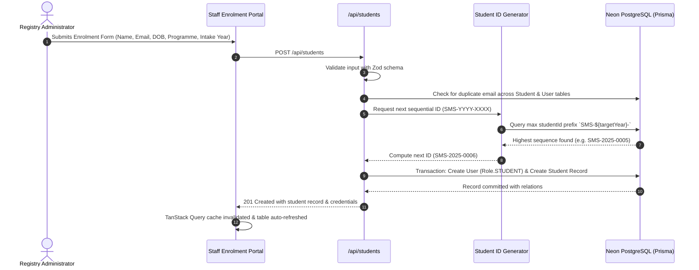

# Student Enrolment & Programmes — Feature Overview

## 1. Scope & Domain Purpose

The **Student Enrolment & Programmes** module (Module 1) establishes the core academic entities of the Student Management System: **Degree Programmes** and **Student Profiles**.

It serves as the prerequisite foundation for all subsequent institutional workflows:
1. **Tuition Fees & Payments Ledger (Module 2):** Programme tuition fees define each student's baseline financial liability.
2. **Assessments & Submissions (Module 3):** Coursework assessments are scheduled and delivered against a student's enrolled degree curriculum.
3. **Marksheets & Results (Module 4):** Final grades and UK degree classifications are awarded per student per module.

---

## 2. Enrolment Sequence & Automated Identity Generation

---

## 3. Key Architectural & Business Rules

### 3.1. Zero-Padded Sequential Student ID Generation
* **Identifier Specification:** `SMS-YYYY-XXXX` (e.g. `SMS-2025-0001`, `SMS-2025-0006`).
* **Intake Partitioning:** The 4-digit `YYYY` segment is resolved dynamically from the student's **Academic Intake Year** string (e.g. `"2024/2025"` or `"2025"`). The resolver extracts the 4-digit intake year via regex, defaulting to the current calendar year if not parsed.
* **Open String Input:** In the enrolment form modal, Academic Intake Year is entered as a free-form string to support flexible institutional cohort formats, without restricting administrators to a static dropdown.
* **Concurrency Protection:** The ID generator queries the active sequence and wraps creation within an atomic database transaction (`prisma.$transaction`) to eliminate collision risks.

### 3.2. Automated Student Portal Provisioning
* When enrolling a student, the registry backend provisions a linked `User` record with role `STUDENT` and default temporary credentials (`Student@12345` hashed via bcrypt).
* This enables newly enrolled students to immediately log into the Student Portal without requiring an out-of-band invitation flow.

### 3.3. Student Enrolment Lifecycle State Machine
A student profile transitions through four discrete states:

| Lifecycle State | Description | Registry Implications |
| :--- | :--- | :--- |
| **`ENROLLED`** | Actively enrolled and attending classes | Eligible for assessment submissions and examination results. |
| **`DEFERRED`** | Studies temporarily paused | Retains active student profile; preserves financial ledger. |
| **`WITHDRAWN`** | Permanently withdrawn from institution | Preserves historical payments and coursework submissions without cascading deletions. |
| **`COMPLETED`** | Successfully graduated from degree | Eligible for final marksheet generation and official transcript issuance. |

### 3.4. Non-Cascading Data Retention Policy
* Student withdrawals (`WITHDRAWN`) do **not** trigger cascading deletes of payments, submissions, or grades. The financial audit trail and academic records remain permanently preserved for regulatory compliance.

### 3.5. High-Performance UUIDv7 Cursor-Based Pagination
* **Time-Ordered Primary Keys:** All entity primary keys in the database utilize time-ordered **UUIDv7** (`@default(uuid(7))`). Because the Unix millisecond timestamp is embedded in the high 48 bits of the UUID, lexicographical ordering (`ORDER BY id DESC`) matches exact chronological creation time.
* **$O(1)$ B-Tree Index Seeking:** Traditional offset-based pagination (`OFFSET N`) suffers from severe $O(N)$ query degradation as tables grow to hundreds of thousands of rows. In contrast, UUIDv7 cursor pagination seeks directly against PostgreSQL's primary key B-Tree index:
  $$\text{WHERE id} < \text{cursor ORDER BY id DESC LIMIT } K + 1$$
* **Next & Previous Navigation:** The backend fetches `limit + 1` rows to calculate `hasNextPage` and extracts the final item's UUIDv7 as `nextCursor`. The frontend preserves a cursor history stack, allowing bidirectional Next/Previous navigation with zero performance degradation on arbitrarily large cohorts.

---

## 4. Degree Programmes & Tuition Fee Architecture

* Degree programmes are managed as first-class domain entities (`Programme` model).
* Each programme configures:
  - Unique uppercase code (e.g. `CS-BSC`, `BA-BUS`, `SWE-BSC`).
  - Degree title (e.g. `BSc Computer Science`).
  - Baseline tuition fee per academic year (e.g. `£9,250`, `£8,500`).
* When a student is enrolled into a programme, their tuition liability is dynamically computed from `programme.tuitionFee`, feeding into Module 2's payment reconciliation ledger.
