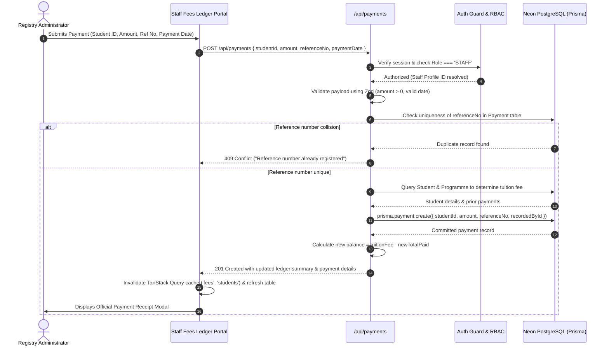

# Fees & Payments Ledger — Feature Overview

## 1. Scope & Domain Purpose

The **Fees & Payments Ledger** module (Module 2) manages institutional tuition fees, payment reconciliation, and debt monitoring within the Student Management System.

Tuition fee liabilities are linked directly to each student's enrolled degree programme (`Programme.tuitionFee`), ensuring institutional consistency. Module 2 provides:
1. **Tuition Fee Binding:** Dynamically calculates each student's baseline fee liability from their enrolled programme.
2. **Payment Transaction Logging:** Records verified payments with unique reference numbers, payment dates, and staff audit linkages.
3. **Real-Time Balance Computation:** Computes outstanding liabilities dynamically:
   $$\text{Outstanding Balance} = \max\left(0, \text{Programme Fee} - \sum \text{Payments}\right)$$
4. **Registry Overdue Debt Detection:** Visually flags students with outstanding balances on the Registry Dashboard and provides an Overdue Accounts management view.
5. **Student Self-Service Ledger:** Gives students instant access to their payment history, outstanding balance, and official electronic receipts.

---

## 2. Financial Ledger Sequence & Payment Recording Workflow

---

## 3. Key Architectural & Business Rules

### 3.1. Dynamic Tuition Fee Assignment
* When a student enrols into a degree programme, their financial liability is determined by `programme.tuitionFee`.
* Changes to individual payments automatically update the computed balance in real-time without denormalized cache drift.

### 3.2. Atomic Payment Reference Uniqueness
* Every payment transaction requires a unique external reference number (`Payment.referenceNo` with `@unique` index).
* Before insertion, the backend verifies that `referenceNo` does not exist in the ledger. Attempting to register an existing reference returns `409 Conflict`.
* An automated reference generator helper (`generateReferenceNumber()`) provides pre-formatted identifiers in the format `PAY-YYYY-XXXXX`.

### 3.3. Dual Audit Trail & Non-Cascading Retention
* Each transaction records both the payer (`studentId`) and the authorizing staff member (`recordedById`).
* When a student record changes status (e.g. `DEFERRED` or `WITHDRAWN`), historical payments are strictly preserved.

### 3.4. Overdue Balance Calculation & Debt Tiers
A student is flagged as **Overdue** if:
$$\text{Balance} = \text{Tuition Fee} - \sum \text{Payments} > 0$$

Students with overdue debt are categorized into three operational urgency tiers:
* **Critical (100% Unpaid):** Total paid = £0 with active tuition liability.
* **Elevated (>50% Remaining):** Partial payments made, but outstanding debt exceeds 50% of the baseline fee.
* **Moderate (<50% Remaining):** More than 50% of the fee has been settled, with a small residual balance remaining.

### 3.5. Role Boundary & Privacy Protections
* **Staff Access:** Registry staff can view institutional financial aggregates, all payment transactions, overdue debt lists, and can record payments against any student.
* **Student Access:** Enrolled students can only inspect their own statement of account and electronic receipts via `/api/students/[id]/fees` (where `id === session.studentProfileId` or `id === 'me'`). Unauthorized student queries return `403 Forbidden`.

### 3.6. UUIDv7 Cursor-Based High-Performance Pagination
* **$O(1)$ B-Tree Index Seeking:** The payment ledger (`Payment.id`) utilizes time-sortable UUIDv7 identifiers. By querying with `cursor: { id }`, `take: limit + 1`, and `skip: 1`, pagination achieves constant-time index traversal without the severe performance degradation of high-offset SQL scans (`OFFSET N`).
* **Bidirectional History Stack:** The UI manages a local navigational stack `cursorHistory: (string | null)[]` enabling instant backward and forward traversing (`nextCursor`, `prevCursor`).
* **Overdue Student Debt Pagination:** The overdue debts endpoint aggregates high-level institutional financial statistics across the entire student body before slicing the paginated student list, ensuring financial metric cards display exact institutional balances without partial-page truncation.

---

## 4. Institutional Finance Metrics

The fees engine computes high-level institutional financial KPIs for registry leadership:
* **Tuition Invoiced:** $\sum \text{Programme Tuition Fees}$ across all registered students.
* **Total Collected:** $\sum \text{Payments}$ credited to student ledgers.
* **Outstanding Debt:** $\sum \text{Unsettled Student Balances}$.
* **Tuition Collection Rate:** $\left(\frac{\text{Total Collected}}{\text{Tuition Invoiced}}\right) \times 100\%$.
* **Overdue Student Count:** Number of enrolled profiles with balance $> 0$.
