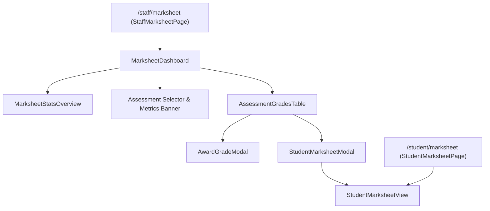

# Marksheet & Results — UI Component Architecture

## 1. Component Hierarchy & Flow

---

## 2. Component Specifications

### 2.1. `MarksheetDashboard`
* **Route:** `/staff/marksheet`
* **Role:** Registry Administrator
* **State Management:**
  * `selectedAssessmentId` *(string)*: Active assessment selected for class grading.
  * `searchTerm` *(string)*: Real-time student search by name, student ID, or email.
  * `statusFilter` *(string)*: Toggle between `'all'`, `'graded'`, `'ungraded'`, `'published'`, and `'draft'`.
  * `classificationFilter` *(string)*: Filter by `'Distinction'`, `'Merit'`, `'Pass'`, `'Fail'`.
  * `page` *(number)*: Pagination tracker.
* **Hook Integration:** `useGrades()`, `useAssessments()`, `useAssessmentGrades(selectedAssessmentId)`.

### 2.2. `MarksheetStatsOverview`
* **Presentation:** 4-card institutional metric grid:
  1. *Grades Awarded:* Total marks awarded with published vs draft split.
  2. *Institutional Mean:* Overall GPA percentage across evaluated assessments.
  3. *High Achievers:* Percentage of students achieving Distinction ($\ge 70\%$) or Merit ($60-69\%$).
  4. *Marksheet Publication:* Release rate with count of remaining drafts requiring Board moderation.

### 2.3. `AssessmentGradesTable`
* **Presentation:** Interactive class grading roster:
  * Student identification: Full name, SMS ID, email.
  * Coursework Deliverable: Submitted file download link, submitted timestamp, on-time vs late flag.
  * Numeric Mark: Score ($0-100$) with visual progress bar.
  * UK Classification: Color-coded badge (`Distinction`, `Merit`, `Pass`, `Fail`).
  * Marksheet Status: Single-click publish/withhold toggle button.
  * Roster Actions:
    * `Award Mark` / `Edit Mark`: Opens `AwardGradeModal`.
    * `Inspect Marksheet`: Opens `StudentMarksheetModal`.
  * Bulk Actions:
    * `Publish All`: One-click release of all awarded marks to student portals.
    * `Withhold All`: Reverts marks to draft state.

### 2.4. `AwardGradeModal`
* **Functionality:** Modal for grading student coursework:
  * Coursework context: Student profile and deliverable link with late submission tags.
  * Numeric Grade Input: Number field ($0–100$) and interactive slider.
  * Live Classification Preview: Real-time badge update (`Distinction`, `Merit`, `Pass`, `Fail`) with degree standard descriptors.
  * Publication Gating Checkbox: Controls whether the grade is published immediately or saved as a draft.

### 2.5. `StudentMarksheetView`
* **Route:** `/student/marksheet` (Student self-service) and embedded in `StudentMarksheetModal` (Staff review).
* **Presentation:** Official university transcript document:
  * Academic Registry & Board of Examiners header with institutional seal.
  * Student Profile & Enrolled Degree Programme banner.
  * Cumulative Academic Standing cards:
    * Cumulative Average GPA (e.g. $84.5\%$).
    * Degree Classification (e.g. *First Class Honours - Distinction*).
    * Passed Modules & Academic Standing.
  * Evaluated Assessment Deliverables table with marks, classifications, and publication dates.
  * Empty state with informative message when results are under Board of Examiners review.
  * Institutional grading scale key and electronic record verification notice.
