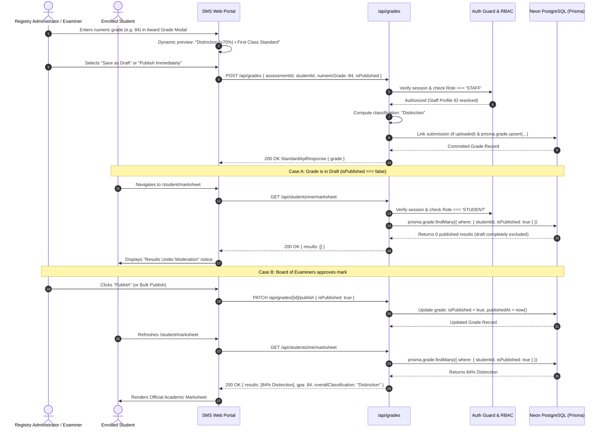

# Marksheet & Results — Feature Overview

## 1. Scope & Domain Purpose

The **Marksheet & Results** module (Module 4) governs academic grading, degree classification computation, publish/withhold access gating, and official transcript generation within the Student Management System.

Grades are awarded by Academic Registry Administrators (`Role === 'STAFF'`) against enrolled student module coursework deliverables. Module 4 provides:

1. **Numeric Grade Entry (0–100):** Staff records numeric marks evaluated against learning objectives.
2. **Automated UK Degree Classification:** Marks are automatically classified according to standard UK higher education degree thresholds:
   * **Distinction (First Class Honours):** $\ge 70\%$
   * **Merit (Upper Second Class 2:1):** $60\% - 69.9\%$
   * **Pass (Third Class / Pass):** $40\% - 59.9\%$
   * **Fail (Resit Required):** $< 40\%$
3. **Strict Publication Gating:** Draft marks undergoing Board of Examiners second-marking and external moderation remain strictly withheld. The database query actively filters `isPublished: true` for student queries, preventing early disclosure or draft leakage.
4. **Granular & Bulk Publication Control:** Registry Staff can publish or withhold marks individually or execute one-click class-wide bulk release once ratified by the Board of Examiners.
5. **Cumulative Academic Standing & GPA:** Computes institutional mean scores, student GPAs, passed modules, and honors eligibility.
6. **Official Academic Transcript & Marksheet:** Board-sealed electronic marksheet with student identification, verification hash, module breakdown, and institutional grading scale key.

---

## 2. Examination Grading & Results Release Sequence



---

## 3. Key Architectural & Business Rules

### 3.1. Compound Uniqueness Constraint
* Each student has at most one grade record per assessment deliverable:
  ```prisma
  @@unique([assessmentId, studentId])
  ```
* Updating a student's grade performs an atomic Prisma `upsert` on the composite key `assessmentId_studentId`.

### 3.2. Automatic Coursework Submission Linking
* Coursework deliverables uploaded by students in Module 3 (`Submission`) are optional but automatically resolved during grading:
  * If a submission exists for `[assessmentId, studentId]`, `submissionId` is linked.
  * If a student was absent or awarded a zero/special consideration mark without an upload, `submissionId` remains `null`.

### 3.3. Strict Database-Level Gating
* When an authenticated student calls `/api/students/[id]/marksheet` or `/api/students/me/marksheet`:
  * The query strictly filters `where: { isPublished: true }`.
  * Unpublished grades are NEVER delivered over the wire to students, eliminating any client-side exposure risk.
* When Registry Staff accesses marksheet endpoints:
  * Both draft and published grades are returned with explicit audit indicators (`isPublished: true | false`).
  * `hasUnpublishedGrades` flag allows staff to monitor ratification progress.

### 3.4. Cumulative Academic Standing Computation
* Student cumulative GPA is calculated as the arithmetic mean of all numeric marks:
  $$\text{GPA} = \frac{\sum_{i=1}^N \text{numericGrade}_i}{N}$$
* Overall award classification is derived directly from the cumulative mean:
  * $\ge 70\%$: **Distinction** (First Class Honours)
  * $60\% - 69.9\%$: **Merit** (Upper Second Class Honours 2:1)
  * $40\% - 59.9\%$: **Pass** (Third Class Honours / Pass)
  * $< 40\%$: **Fail** (Unclassified / Resit Required)
