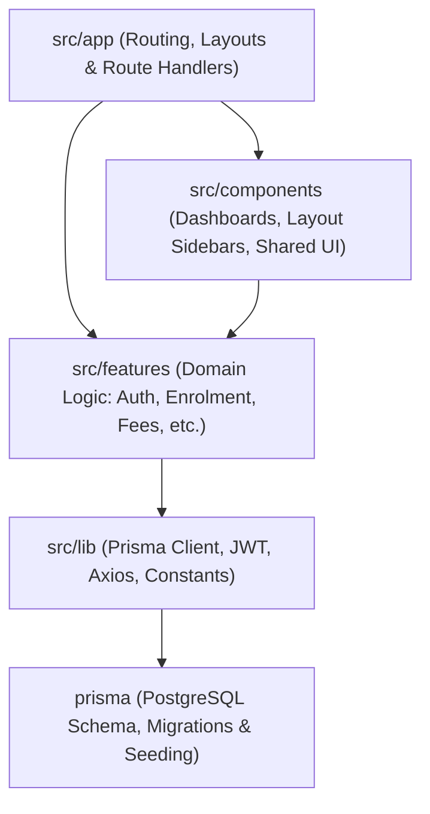

# Technical Documentation Hub

Welcome to the **Student Management System (Registry Module)** Developer & Architecture Documentation.

This hub provides comprehensive feature specifications, API contracts, UI component architectures, and data flows for each modular domain feature of the application.

---

## Architecture Blueprint

The application follows a **Modular Feature-Driven Architecture**, separating core domain boundaries while leveraging Next.js 16 (App Router) with Turbopack:



---

## Directory & Component Separation Standards

To keep the codebase maintainable and strictly organized:

1. **`src/features/[feature-name]/` (Domain-Only Boundaries)**:
   * Repeatable architectural blueprint for any business feature (scales cleanly from 1 to 100+ features).
   * Every feature self-contains its localized `components/`, `hooks/`, `services/`, `types/`, `utils/`, and public `index.ts`.
   * Non-feature generic elements (e.g., app shells, dashboards, layout sidebars) are strictly kept out of `features/`.

2. **`src/components/` (Application Presentation Layer)**:
   * **`dashboard/`**: Role-based overview dashboards and summary cards.
   * **`layout/`**: Responsive application shell (fixed sidebars, mobile drawers, navigation).
   * **`shared/`**: Reusable design primitives across the app (badges, stat cards, page headers).
   * **`providers/`**: Global React context wrappers and client state providers (`QueryProvider`).
   * Comprehensive guide: [UI & Component Architecture Guide](./components/overview.md).

3. **`src/lib/` (Shared Infrastructure & Utilities)**:
   * Foundational, non-domain singletons, security infrastructure, networking interceptors, and standardization contracts.
   * Houses database pool management (`prisma.ts`), isomorphic JWT cryptography (`jwt.ts`), server RBAC route barriers (`auth-guard.ts`), automated 401 refresh interceptors (`axios.ts`), and standardized JSON response shells (`api-response.ts`).
   * Comprehensive guide: [Shared Infrastructure & Utilities Guide](./lib/overview.md).

---

## Feature Documentation Index

| Feature Module | Status | Technical Documentation |
| :--- | :--- | :--- |
| **Module 0: Authentication & Role Authorization** | 🟢 Complete | [Overview](./features/auth/overview.md) • [API](./features/auth/api.md) • [Components](./features/auth/components.md) |
| **Module 1: Student Enrolment & Programmes** | 🟢 Complete | [Overview](./features/enrolment/overview.md) • [API](./features/enrolment/api.md) • [Components](./features/enrolment/components.md) |
| **Module 2: Fees & Payments Ledger** | 🟢 Complete | [Overview](./features/fees/overview.md) • [API](./features/fees/api.md) • [Components](./features/fees/components.md) |
| **Module 3: Assessment Submission** | 🟢 Complete | [Overview](./features/assessments/overview.md) • [API](./features/assessments/api.md) • [Components](./features/assessments/components.md) |
| **Module 4: Marksheet & Results** | 🟢 Complete | [Overview](./features/grades/overview.md) • [API](./features/grades/api.md) • [Components](./features/grades/components.md) |

---

## Security & Session Architecture

* **Dual-Token JWT:** Short-lived access tokens (15 minutes) paired with rotating refresh tokens (7 days).
* **Storage:** Stored in browser `httpOnly`, `SameSite=Lax` cookies to prevent client-side XSS exfiltration.
* **Database Tracking:** Refresh tokens are hashed using SHA-256 and tracked in the `RefreshToken` database table to enable instant session revocation and detect token reuse attacks.
* **Edge Route Guards:** Next.js `proxy.ts` intercepts `/staff/*` and `/student/*` requests to enforce role boundaries before route rendering.
* **Server Session Guard (`auth-guard.ts`):** `getSessionUser`, `requireStaff`, and `requireStudent` extract session users directly from cookies, verify database linkages, and ensure strict RBAC access barriers on API route handlers.

---

## Standardized API Response Specification

All API endpoints strictly conform to a 4-property standard response contract (`src/lib/api-response.ts`):
```typescript
interface StandardApiResponse<T = unknown, M = unknown> {
  success: boolean;       // Operation success status (true | false)
  message: string;        // Human-readable status or error description
  data: T;                // Primary payload data (objects, arrays; null on failure)
  meta?: M;               // Optional metadata (pagination, metrics, flags)
}
```
Helper utilities `apiSuccess(data, message, meta, status)` and `apiError(message, status, data, meta)` guarantee uniformity across all backend routes and client consumers.
