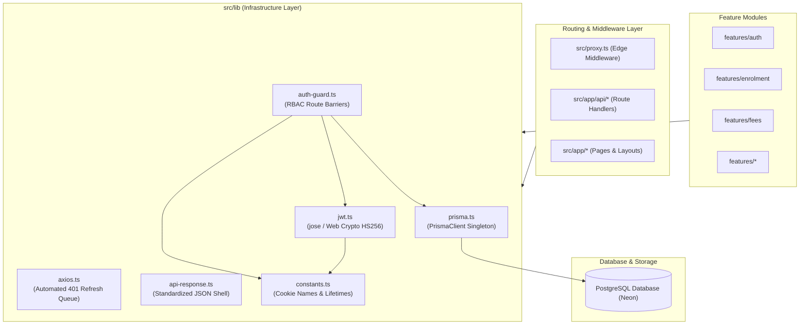
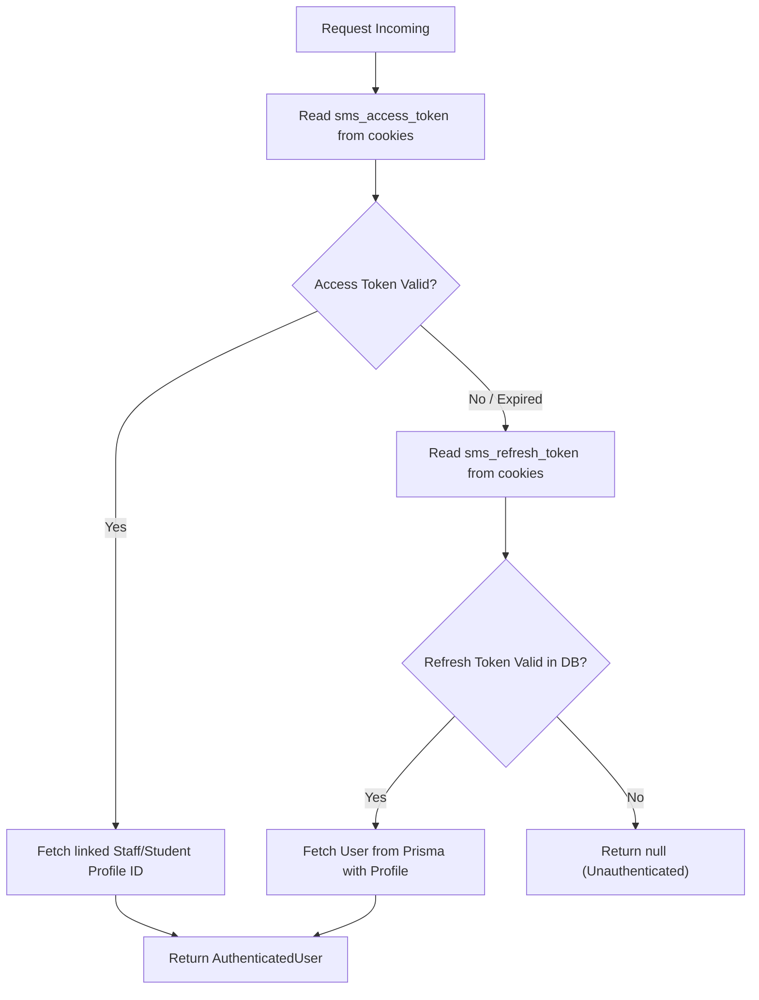

# Shared Infrastructure & Utilities Architecture (`src/lib/`)

This document outlines the organization, technical specifications, and security policies for shared infrastructure utilities and global singletons located under `src/lib/`.

---

## 1. Architectural Role & Boundary Philosophy

`src/lib/` represents the foundational infrastructure layer of the application. It provides domain-agnostic singletons, cryptographic helpers, networking interceptors, session barriers, and standardized API contracts.

### Strict Dependency Rules:
1. **Unidirectional Inward Dependency:** Domain modules (`src/features/*`), route handlers (`src/app/api/*`), and application pages (`src/app/*`) may import from `src/lib/`.
2. **Zero Inversion of Control:** `src/lib/` must **never** import from `src/features/` or `src/components/`. It remains strictly foundational and domain-agnostic.
3. **Isomorphic Runtime Safety:** Utilities used by edge middleware (such as `proxy.ts`) and route handlers must avoid Node.js-only legacy modules (e.g. `crypto.createHash`) in favor of universal Web Crypto standards (`crypto.subtle`).



---

## 2. Infrastructure Directory Breakdown

| File | Primary Responsibility | Target Runtime | Key Exports |
| :--- | :--- | :--- | :--- |
| **`prisma.ts`** | Global Prisma Client singleton & connection pooling | Node.js Server | `prisma`, `default prisma` |
| **`jwt.ts`** | Dual-token signing, verification & SHA-256 hashing | Universal / Edge | `signAccessToken`, `signRefreshToken`, `verifyAccessToken`, `verifyRefreshToken`, `hashToken` |
| **`auth-guard.ts`** | Server-side session resolution & role authorization barriers | Node.js Server | `getSessionUser`, `requireStaff`, `requireStudent` |
| **`axios.ts`** | HTTP client with automated 401 refresh interceptor queue | Browser / Client | `api`, `default api` |
| **`api-response.ts`** | Standardized 4-property API JSON contract helpers | Node.js Server | `apiSuccess`, `apiError`, `StandardApiResponse` |
| **`constants.ts`** | Single-source-of-truth cookie names & token lifetimes | Universal | `COOKIES`, `TOKEN_EXPIRY` |

---

## 3. Deep-Dive Module Specifications

### 3.1. Database Singleton (`src/lib/prisma.ts`)

In Next.js development mode, Turbopack and fast-refresh frequently re-evaluate modules on code changes. Creating a new `PrismaClient` on every hot-reload rapidly exhausts PostgreSQL's connection pool.

`prisma.ts` implements the global singleton pattern using `globalThis`:

```typescript
import { PrismaClient } from '@prisma/client';

const globalForPrisma = globalThis as unknown as {
  prisma: PrismaClient | undefined;
};

export const prisma =
  globalForPrisma.prisma ??
  new PrismaClient({
    log: process.env.NODE_ENV === 'development' ? ['warn', 'error'] : ['error'],
  });

if (process.env.NODE_ENV !== 'production') globalForPrisma.prisma = prisma;

export default prisma;
```

* **Production Behavior:** In production, a single instance is instantiated per serverless container / Node.js process.
* **Logging Strategy:** Configured to log warnings and errors in development; only errors in production.

---

### 3.2. Cryptography & Dual-Token Engine (`src/lib/jwt.ts`)

Authentication relies on high-performance dual-token JWTs built with **`jose`** and the native **Web Crypto API**:

#### Token Claims & Lifetimes:
1. **Access Token (`15m`):**
   * Encodes user claims: `userId`, `email`, `role` (`'STAFF'` | `'STUDENT'`), `name`, `staffId`, and `studentId`.
   * Signed with `process.env.JWT_ACCESS_SECRET` using HMAC SHA-256 (`HS256`).
2. **Refresh Token (`7d`):**
   * Encodes only `{ userId }`.
   * Signed with `process.env.JWT_REFRESH_SECRET` using `HS256`.

#### Edge-Compatible Token Hashing:
Refresh tokens stored in the database are hashed to protect user sessions in case of database exfiltration. Rather than relying on Node-specific libraries (`crypto.createHash`), `jwt.ts` utilizes the standard Web Crypto API (`crypto.subtle`):

```typescript
export async function hashToken(token: string): Promise<string> {
  const encoder = new TextEncoder();
  const data = encoder.encode(token);
  const hashBuffer = await crypto.subtle.digest('SHA-256', data);
  const hashArray = Array.from(new Uint8Array(hashBuffer));
  return hashArray.map((b) => b.toString(16).padStart(2, '0')).join('');
}
```
* **Edge Compatibility:** Runs seamlessly within Next.js Edge Middleware (`proxy.ts`) without polyfills.

---

### 3.3. Route Handler RBAC Barriers (`src/lib/auth-guard.ts`)

Every backend REST route handler (`/api/*`) enforces session authentication and role-based access control (RBAC) via `auth-guard.ts`.

#### Resolution Hierarchy (`getSessionUser`):


#### Guard Functions:
* **`getSessionUser(req)`**: Resolves the user session, automatically linking `staffProfileId` or `studentProfileId` for fast relational queries.
* **`requireStaff(req)`**: Validates active session and confirms `user.role === 'STAFF'`. Returns `null` if unauthorized.
* **`requireStudent(req)`**: Validates active session and confirms `user.role === 'STUDENT'`. Returns `null` if unauthorized.

---

### 3.4. HTTP Client with Automated 401 Refresh Queue (`src/lib/axios.ts`)

The frontend interacts with backend API routes via a preconfigured Axios instance (`api`). It automates access token rotation using a synchronized promise queue.

#### Seamless Token Refresh Flow:
1. A client component triggers a request with an expired access token.
2. The server responds with `401 Unauthorized`.
3. The Axios response interceptor intercepts the 401:
   - Sets `isRefreshing = true`.
   - Any concurrent API calls received while refreshing are queued in `failedQueue`.
   - Issues a single `POST /api/auth/refresh` request to rotate the tokens.
   - On success, resolves all queued promises and automatically replays the original requests with new session credentials.
4. **Infinite Loop Protection:** Bypasses interceptor logic on `/api/auth/login`, `/api/auth/refresh`, and `/api/auth/logout`.

```typescript
// Credentials configuration
export const api = axios.create({
  headers: { 'Content-Type': 'application/json' },
  withCredentials: true, // Guarantees httpOnly auth cookies accompany requests
});
```

---

### 3.5. Standardized API Response Shell (`src/lib/api-response.ts`)

All API routes uniformly format JSON responses using a predictable 4-property schema:

```typescript
export interface StandardApiResponse<T = unknown, M = unknown> {
  success: boolean;       // Operation success status (true | false)
  message: string;        // Human-readable status or error description
  data: T;                // Primary payload data (null on failure)
  meta?: M;               // Optional metadata (pagination, aggregate stats)
}
```

#### Helper Methods:
* **`apiSuccess(data, message, meta, status = 200)`**:
  Constructs a standard JSON success response:
  ```json
  {
    "success": true,
    "message": "Payment recorded successfully",
    "data": { ... },
    "meta": { "total": 10 }
  }
  ```
* **`apiError(message, status = 400, data = null, meta)`**:
  Constructs a standard JSON error response:
  ```json
  {
    "success": false,
    "message": "Payment reference is already registered",
    "data": null
  }
  ```

---

### 3.6. Constants & Configuration (`src/lib/constants.ts`)

Central repository of immutable configuration values:

```typescript
export const COOKIES = {
  ACCESS_TOKEN: 'sms_access_token',
  REFRESH_TOKEN: 'sms_refresh_token',
} as const;

export const TOKEN_EXPIRY = {
  ACCESS_SECONDS: 15 * 60,            // 15 minutes
  REFRESH_SECONDS: 7 * 24 * 60 * 60,   // 7 days
} as const;
```

---

## 4. Best Practices & Guidelines for Developers

1. **Always use `apiSuccess` and `apiError`:** Never return raw `NextResponse.json({ error: '...' })`. Consistent client handling requires the `{ success, message, data, meta }` shape.
2. **Never expose secrets to client:** Keys like `JWT_ACCESS_SECRET` must **never** be prefixed with `NEXT_PUBLIC_`.
3. **Always use `api` from `@/lib/axios`:** Avoid raw `fetch()` or default `axios.get()` in client hooks; only the configured `api` instance automatically handles `withCredentials` and 401 token refresh queueing.
4. **Prefer `requireStaff` / `requireStudent`:** Do not implement manual cookie checks or role verification inside route handlers; use the centralized guards in `auth-guard.ts`.
